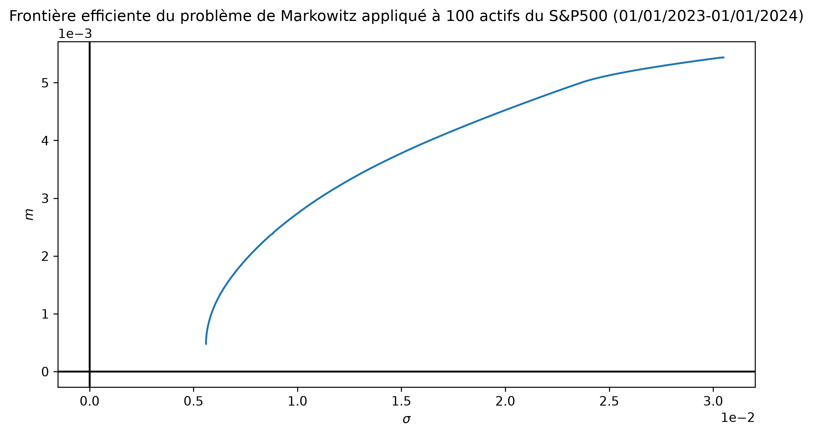
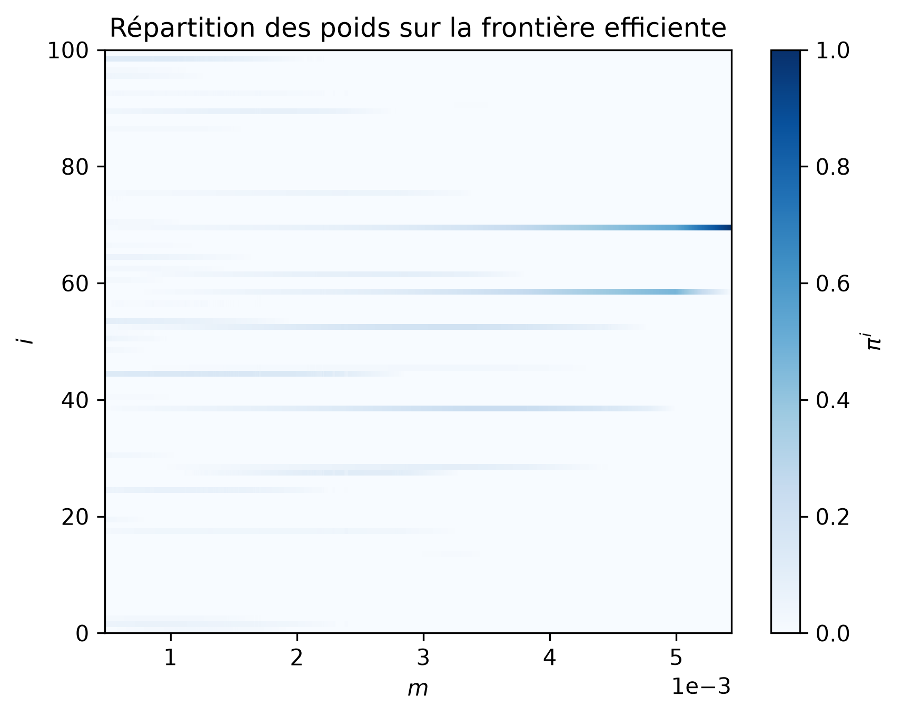
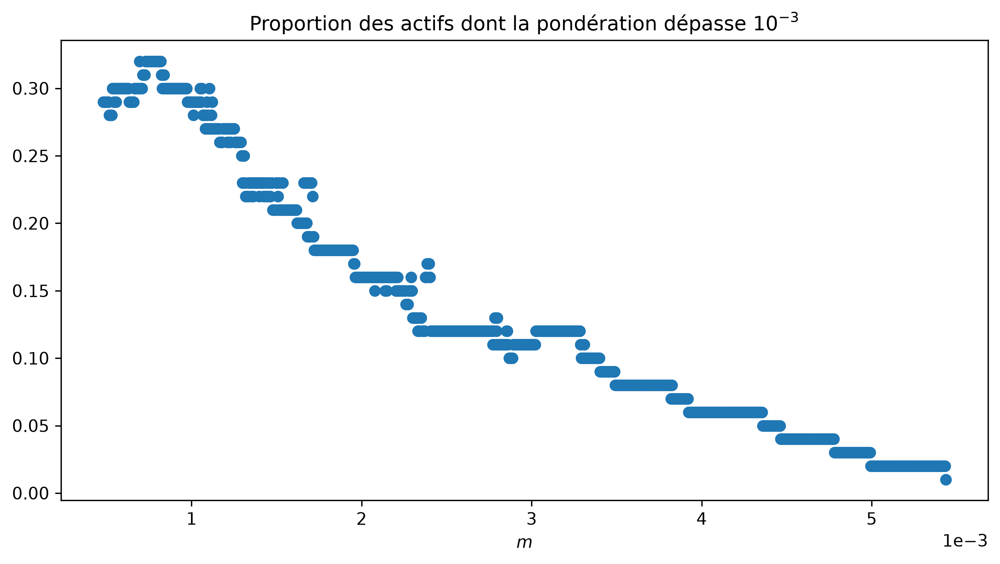
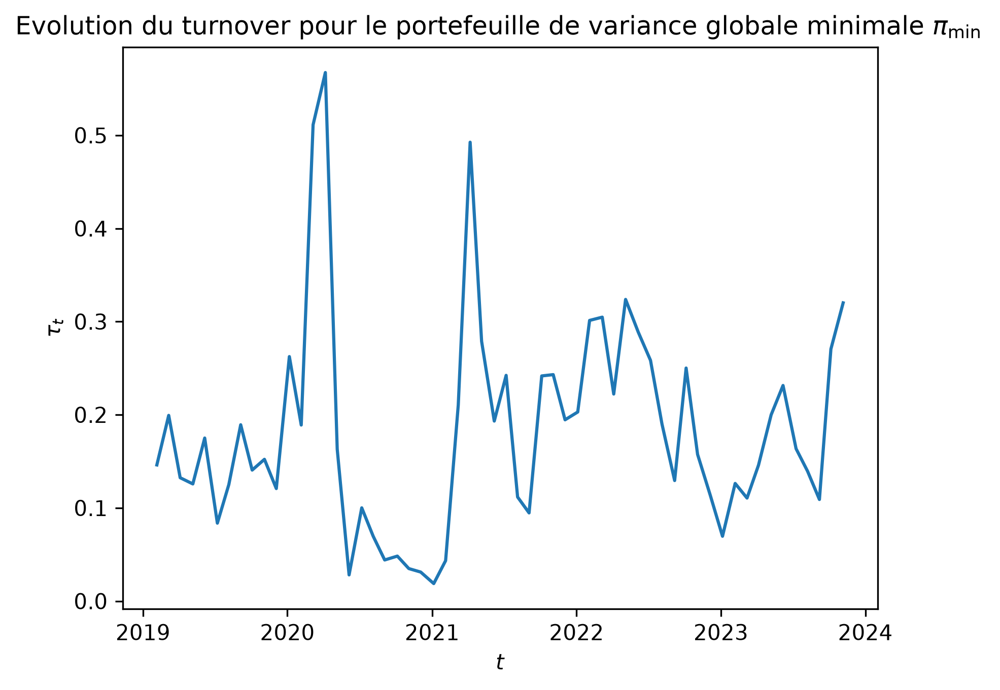
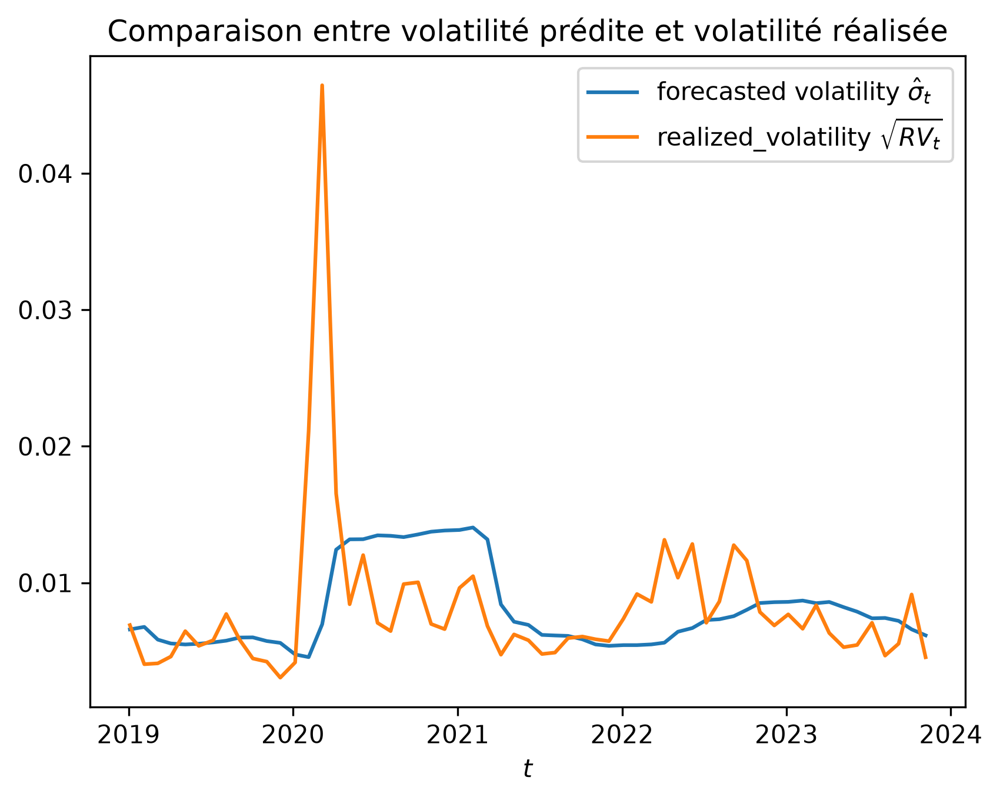
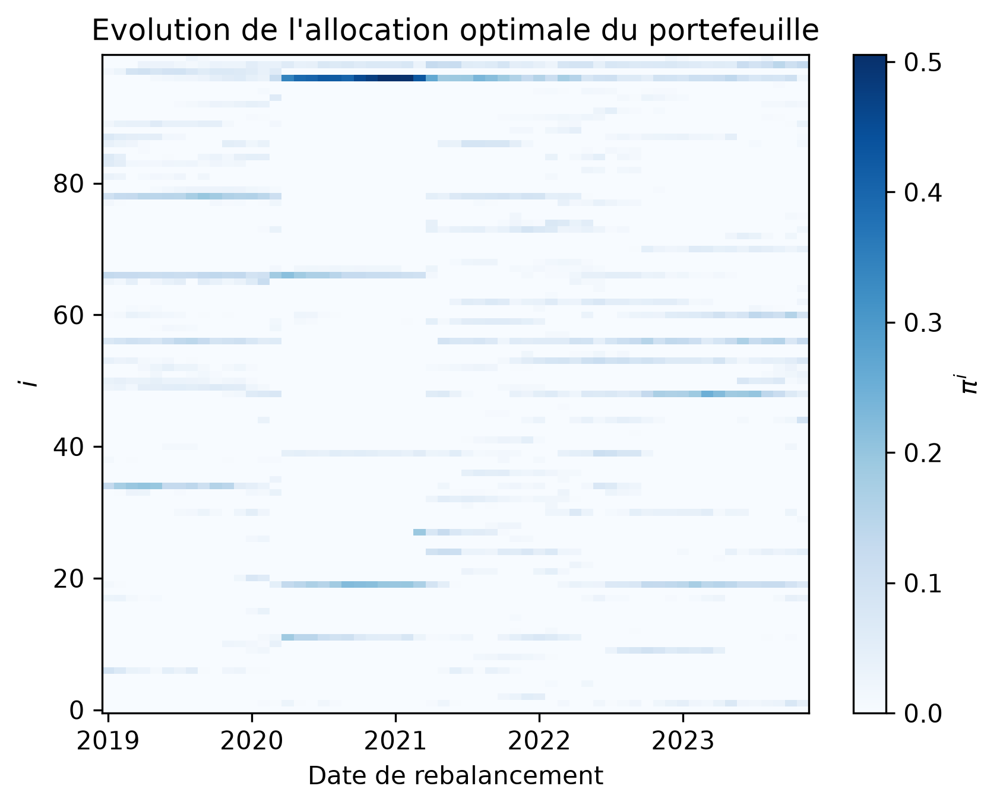
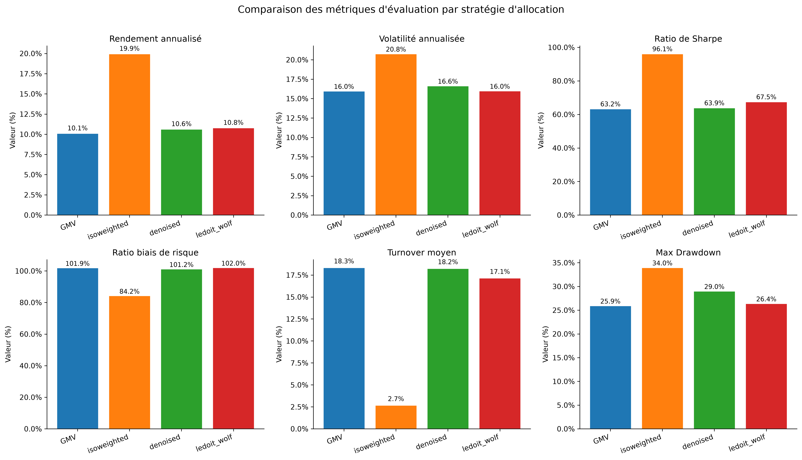
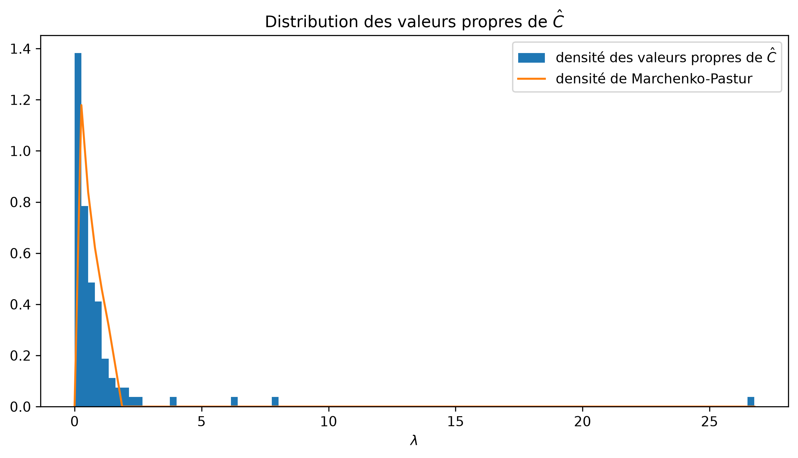

# Portfolio Optimization & Régularisation spectrale

> **Objectif :** Traiter le problème du bruit dans les matrices de covariance de grande dimension, en comparant plusieurs méthodes de régularisation appliquées à l'optimisation de portefeuille sur un univers de titres du S&P 500.

---

## Structure du projet

```
PortfolioOptimization/
├── portfolio_optimization/        # Module principal d'optimisation
│   ├── data_loader.py             # Téléchargement et calcul des moments empiriques
│   ├── optimizer.py               # Résolution de la frontière efficiente (cvxpy / OSQP)
│   ├── allocation.py              # Stratégies d'allocation (GMV, isopondéré, débruité, Ledoit-Wolf)
│   ├── evaluation.py              # Évaluation out-of-sample (Sharpe, drawdown, turnover…)
│   └── utils.py                   # Constantes et helpers
├── spectral_analysis/             # Module d'analyse spectrale
│   └── denoising.py               # Débruitage via théorie des matrices aléatoires (RMT)
├── portfolio_optimization.ipynb   # Notebook principal : Markowitz naïf → comparaison de stratégies
├── spectral_filtering.ipynb       # Notebook : visualisation spectrale et loi de Marchenko-Pastur
├── outputs/                       # Graphiques exportés (PNG 300 dpi)
├── page_notion.pdf                # Notes de cours et cadre théorique du projet
└── requirements/
    ├── base.txt
    └── local.txt
```

---

## Cadre théorique

### Hypothèses du modèle
- **Univers** : $d$ actifs risqués du S&P 500 (∼100 titres après nettoyage)
- **Contraintes** : portefeuille long-only ($\pi_i \geq 0$), budget ($\mathbf{1}^\top \pi = 1$), pas de vente à découvert
- **Données** : rendements journaliers via `yfinance`, nettoyage à 95 % de valeurs disponibles

### Problème d'optimisation (Markowitz)
$$\min_{\pi \in [0,1]^d} \pi^\top \hat{\Sigma} \pi \quad \text{s.t.} \quad \mathbf{1}^\top \pi = 1,\; \pi^\top \hat{M} \geq m$$

La frontière efficiente est tracée en faisant varier $m$ entre le rendement minimal du portefeuille GMV et le rendement maximal d'un actif individuel. Le solveur utilisé est **OSQP** (Operator Splitting Quadratic Program), robuste aux matrices semi-définies positives.

---

## Ce qui a été accompli

### 1. `portfolio_optimization.ipynb` — Modèle de Markowitz naïf

**Approche statique :**

- Calcul de la frontière efficiente sur une fenêtre 2023–2024
- Visualisation de la frontière dans l'espace risque/rendement ($\sigma$, $m$)



- Mise en évidence de l'**hyper-concentration des poids** : seule une poignée d'actifs reçoit une pondération significative, et les poids sautent brutalement lorsqu'on déplace légèrement $m$





**Approche dynamique (évaluation out-of-sample) :**

- Rééquilibrage périodique toutes les `DELTA_T = 21` jours sur une fenêtre glissante de `T = 252` jours (2018–2024)



- Calcul et comparaison de la volatilité prédite vs réalisée



- Visualisation de l'instabilité de la composition du portefeuille au fil du temps



- **Comparaison de 4 stratégies** via le module `evaluation.py` :

| Stratégie | Description |
|-----------|-------------|
| **GMV** | Portefeuille de variance globale minimale (covariance empirique brute) |
| **Isopondéré** | $1/d$ sur chaque actif, référence passive |
| **Denoised GMV** | GMV avec covariance débruitée par eigenvalue clipping (RMT) |
| **Ledoit-Wolf GMV** | GMV avec covariance régularisée par shrinkage linéaire |

- Métriques calculées : rendement annualisé arithmétique, volatilité annualisée, ratio de Sharpe, risk-bias ratio (volatilité réalisée / prédite), turnover moyen, max drawdown



---

### 2. `spectral_filtering.ipynb` — Analyse spectrale

- Calcul du **ratio de concentration** $q = d/T$ sur l'univers S&P 500
- Décomposition spectrale de la matrice de corrélation empirique $\hat{C}$
- **Ajustement de la loi de Marchenko-Pastur** : estimation de la variance du bruit $\sigma^2$ par minimisation de l'écart quadratique entre la densité empirique des valeurs propres (KDE) et la densité théorique MP



---

### 3. `spectral_analysis/denoising.py` — Eigenvalue Clipping

Implémentation complète du débruitage par la **théorie des matrices aléatoires (RMT)** :

1. Conversion covariance → corrélation
2. Décomposition spectrale ($\hat{C} = U \Lambda U^\top$)
3. Estimation de $\sigma^2$ (variance du bruit) par fit de la loi de Marchenko-Pastur
4. Calcul des bornes du bulk : $\lambda_\pm = \sigma^2 (1 \pm \sqrt{q})^2$
5. **Eigenvalue clipping** : toutes les valeurs propres $\leq \lambda_+$ sont remplacées par leur moyenne (élimination du bruit de Marchenko-Pastur)
6. Reconstruction de la matrice de corrélation clippée et repassage en covariance

---

### 4. `portfolio_optimization/` — Stratégies d'allocation

| Fichier | Contenu |
|---------|---------|
| `data_loader.py` | `fetch_returns` (yfinance), `compute_empirical_moments` (moyenne + covariance symétrisée) |
| `optimizer.py` | `solve_global_min_variance` et `solve_efficient_border` via cvxpy/OSQP |
| `allocation.py` | 4 allocateurs : `GMV_allocator`, `isoweighted_allocator`, `denoised_GMV_allocator`, `ledoit_wolf_GMV_allocator` |
| `evaluation.py` | Classe `Evaluation` et fonction `out_of_sample_evaluation` : backtesting avec drift des poids entre rééquilibrages |

Le **Ledoit-Wolf shrinkage** est intégré via `sklearn.covariance.LedoitWolf` avec correction du biais ($\times T/(T-1)$) pour obtenir la covariance non biaisée.

---

## Résultats clés

> [!NOTE]
> Ces résultats correspondent à l'évaluation out-of-sample sur 2018–2024 avec rééquilibrage mensuel et fenêtre d'estimation d'un an.

- Les **trois variantes GMV** réduisent la volatilité par rapport au portefeuille équipondéré, conformément à la théorie
- Le **débruitage spectral (RMT)** a un impact marginal en univers long-only : la contrainte $\pi_i \geq 0$ joue déjà le rôle de régularisateur implicite en éliminant les combinaisons exploitant les petites valeurs propres
- Le **Ledoit-Wolf** améliore le ratio de Sharpe et réduit légèrement le turnover en rétractant les volatilités individuelles vers la moyenne
- Le portefeuille **équipondéré** affiche un rendement et un Sharpe plus élevés, mais au prix d'une volatilité et d'un drawdown supérieurs
- Le **risk-bias ratio** (volatilité réalisée / prédite) reste très inférieur à 1 pour toutes les variantes GMV, indiquant que le modèle sous-estime systématiquement la volatilité réalisée

---

## Pour aller plus loin

- Relâcher la contrainte long-only pour observer pleinement l'effet du débruitage spectral
- Explorer le **shrinkage non-linéaire** (fonction $\phi(\lambda_i)$ appliquée individuellement à chaque valeur propre)
- Tester sur des horizons de rééquilibrage différents ou des fenêtres d'estimation variables
